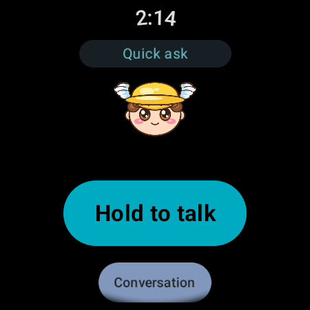
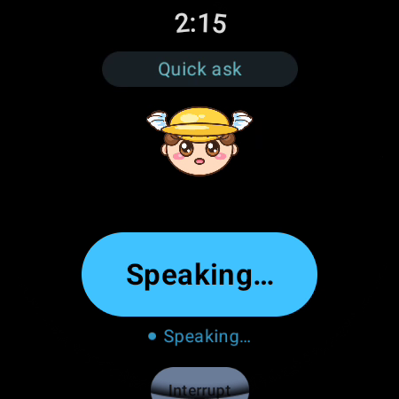
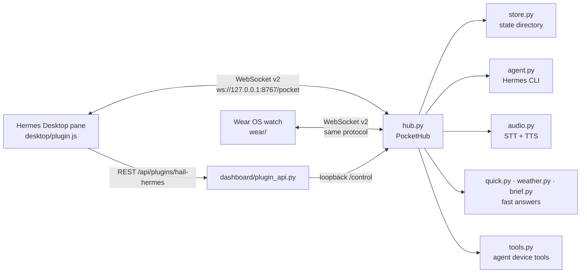

<p align="center"></p>

<h1 align="center">Hail Hermes</h1>

<p align="center"><em>Talk to your Hermes agent out loud — in the desktop panel, or from a watch it pairs with in four digits.</em></p>

<p align="center">
  <a href="https://github.com/KeyArgo/hail-hermes/actions/workflows/wear.yml"></a>
  <a href="TESTING.md"></a>
  <a href="https://github.com/KeyArgo/hail-hermes/releases/latest"></a>
  <a href="LICENSE"></a>
  <a href="https://github.com/NousResearch/hermes-agent"></a>
  
  
  <a href="https://github.com/KeyArgo/hail-hermes/stargazers"></a>
</p>

<p align="center"><br/><sub>The watch answers out loud, and the face moves only while real audio is playing.</sub></p>

<p align="center"><a href="#install">Install</a> · <a href="#features">Features</a> · <a href="#how-it-works">How it works</a> · <a href="#documentation">Documentation</a> · <a href="#testing">Testing</a> · <a href="#contributing">Contributing</a></p>

## What it is

Hail Hermes is a Hermes Agent plugin: a hub, a desktop panel, and an optional Wear OS watch
client. It gives your self-hosted agent a voice, a face, proactive nudges, and device sensors as
agent tools. **The panel is the product and needs no hardware**; the watch is the extension you
pair later.

## Why it's different

- **Voice that is honest about itself.** The reply is spoken; the face moves only while audio is
  actually playing. Kill the hub mid-sentence and both stop on the same frame.
- **The agent starts the conversation.** Scheduled nudges reach you: "You said you'd reply to Sam by
  Friday. It's Thursday."
- **Sessions on the wrist.** "Continue the project I started on Tuesday" resolves to a real folder,
  not a new chat.
- **Any model, including local.** Hermes subscription, LM Studio, Ollama, vLLM — switch live, and the
  panel's header says which one is answering.
- **A weather fast path** that answers "will it rain?" in about three seconds without a model round
  trip.
- **Built to be checked, not believed.** 409 tests passed in the recorded suites (plugin, simulator,
  face generator; 1 skipped), a simulator that needs no hardware, a headless harness that clicks
  every control, and a static-analysis gate that fails the build on new findings. The panel header
  names the build it is running, read from the hub itself — so the number you see is the number that
  answers.

## Features

- **Talk:** the live watch mirror drawn in CSS, hold to talk, a text box, and a one-press guided
  demo. A watch asking to pair raises a banner here.
- **Sessions:** your past conversations, with Open in Hermes.
- **Character:** personality templates, voice with ▶ preview, and a face of your own.
- **Settings:** the setup check, brain and voice, everything else.
- **Watch:** behind **More** — let my watch connect, approve the code, paired devices. The panel is
  the product; the watch is the extension, so it is not a peer tab.
- **Header:** one pill says what the panel is doing and opens Settings — `Ready · Quick ask`, or
  `Hub not running` when it cannot reach the hub.
- **Four agent tools** while a device is connected: `device_notify`, `device_say`,
  `device_haptic`, `device_battery`.
- **Automatic recovery:** the watch reconnects by itself after the hub restarts or the network
  drops, and keeps the same sessions.
- **Weather and day briefs without a model round trip**, answered from Open-Meteo or a local
  `brief.json`.

## Screenshots

<table>
<tr>
<td width="50%"><br/><sub><b>Ready.</b> Hold to talk, or start a hands-free conversation.</sub></td>
<td width="50%"><br/><sub><b>Speaking.</b> The mouth animates only while audio plays.</sub></td>
</tr>
</table>

The panel itself is a page inside Hermes Desktop and cannot be served outside the host, so the two
watch screenshots above are the product images in this README. Both were captured from a Galaxy
Watch 5 Pro paired with the hub and match the current watch UI.

## Install

```bash
hermes plugins install KeyArgo/hail-hermes --yes-deps --enable
```

Requirements: Hermes Agent, Python 3.11 or newer, and `ffmpeg` for speech (`hermes pm install
--tools-only` once if the setup check flags it). The watch app is optional; it needs Wear OS 3 or
newer and the APK from the latest release. Everything runs on your own network.

Upgrade with the same command, or `hermes plugins update hail-hermes`. Uninstall with `hermes
plugins remove hail-hermes`; see [docs/INSTALL.md](docs/INSTALL.md) for the watch steps and
[docs/CONFIGURATION.md](docs/CONFIGURATION.md) for where data lives and how to delete it.

## Quick start

1. Restart Hermes Desktop and click **Hail Hermes** in the left rail — the plugin is a page in the
   app, not a window behind a chip (the status-bar ⌚ and `Alt+Shift+H` are the quick paths).
2. Press **Check my setup**, then **Run the 60-second demo**: three real questions, answered aloud
   through the real hub, with no watch involved.
3. Pairing a watch is optional — [docs/INSTALL.md](docs/INSTALL.md) has the steps, and the panel
   does everything without one.

## How it works



`protocol.py` is the contract every client implements ([protocol/PROTOCOL.md](protocol/PROTOCOL.md)).
`hub.py` owns connections, pairing and turns; `store.py` keeps paired-device token hashes and the
live snapshot; `agent.py` resumes a real Hermes session through the CLI; `audio.py` selects the
speech backend; `quick.py`, `weather.py` and `brief.py` answer short questions without a model
round trip. The pane's backend lives in `plugin/hail_hermes/dashboard/plugin_api.py`, reached over
the loopback-only `/control` channel.

## Documentation

| Document | What is in it |
|---|---|
| [docs/README.md](docs/README.md) | Index of every document in this repo |
| [docs/INSTALL.md](docs/INSTALL.md) | Install the plugin and, if you have one, the watch |
| [docs/USAGE.md](docs/USAGE.md) | Every user-facing feature as a walkthrough |
| [docs/ARCHITECTURE.md](docs/ARCHITECTURE.md) | Components, data flow, files on disk |
| [docs/CONFIGURATION.md](docs/CONFIGURATION.md) | Every setting, environment variable and config key |
| [docs/REFERENCE.md](docs/REFERENCE.md) | Tools, CLI, hooks, HTTP routes, config keys |
| [docs/FAQ.md](docs/FAQ.md) | Short answers to the questions the code raises |
| [docs/DEVELOPMENT.md](docs/DEVELOPMENT.md) | Repo layout, test commands, how CI works |
| [docs/TROUBLESHOOTING.md](docs/TROUBLESHOOTING.md) | Real failure modes and what to do |
| [docs/SECURITY.md](docs/SECURITY.md) | Pairing, tokens, network surface, what is not protected |
| [docs/DEMO-SCRIPT-PANEL.md](docs/DEMO-SCRIPT-PANEL.md) | 90-second demo, panel first |
| [docs/DEMO-SCRIPT.md](docs/DEMO-SCRIPT.md) | 90-second demo on a physical watch |
| [docs/PLUGIN-DESIGN.md](docs/PLUGIN-DESIGN.md) | The agreed plugin-first design |
| [docs/ROADMAP.md](docs/ROADMAP.md) | Where new ideas go, with verdicts |
| [docs/TEST-ON-WATCH.md](docs/TEST-ON-WATCH.md) | Testing a build on the watch |
| [docs/WATCH-CHECKLIST.md](docs/WATCH-CHECKLIST.md) | Six checks in about a minute |
| [docs/THIRD-PARTY.md](docs/THIRD-PARTY.md) | Libraries and assets this repo uses |
| [protocol/PROTOCOL.md](protocol/PROTOCOL.md) | The protocol contract, v2 |
| [TESTING.md](TESTING.md) | How to run each suite, recorded results, what CI runs |
| [CHANGELOG.md](CHANGELOG.md) | Release history and the identity rules |
| [CONTRIBUTING.md](CONTRIBUTING.md) | Dev setup, tests, commit style, PR flow |
| [CODE_OF_CONDUCT.md](CODE_OF_CONDUCT.md) | Contributor Covenant 2.1 |
| [SECURITY.md](SECURITY.md) | How to report a vulnerability |
| [android/README.md](android/README.md) | The phone client (not part of the 1.0.0 watch path) |
| [wear/README.md](wear/README.md) | The Wear OS client |
| [tools/facesmith/README.md](tools/facesmith/README.md) | The mascot frame generator |

## Privacy & security

- **What it stores.** Everything lives under `<profile>/hail-hermes` (or `$HAIL_HERMES_STATE`;
  legacy `<profile>/pocket` is still used when it exists). That includes `settings.json`,
  `devices.json` (SHA-256 token hashes, never raw tokens), `control.token`, `hub.id`, `live.json`,
  `turns.jsonl`, `hub.log`, `brief.json`, `soul.md` and an uploaded face image. No telemetry and no
  self-updater.
- **Network.** The hub listens on `ws://127.0.0.1:8767/pocket` by default. **Let my watch connect**
  turns on LAN listeners and a UDP discovery beacon on port 8768 carrying hostname, port and a short
  fingerprint — no tokens, no session data. The weather fast path makes HTTPS requests to Open-Meteo
  (the forecast, and its keyless geocoder when you name a place) and stores nothing. Model traffic
  goes to whichever endpoint you configure. LAN traffic is cleartext and documented as such.
- **Background processes.** The pane can auto-start one hub per state directory. Speech workers
  (Kokoro/Parakeet/Piper) are separate processes started on demand; `ffmpeg` is used when a speech
  backend needs it.
- **Shell commands.** The hub runs the `hermes` CLI to answer a turn and list sessions. `hermes hail
  watch` uses `adb` only when you run it. Installing the plugin runs the normal Hermes dependency
  install.
- **Credentials.** The model list never reads `.env` or `auth.json`; it reports names the
  configuration and local endpoints expose, and Hermes decides whether a model is authorised.

Read [SECURITY.md](SECURITY.md) for reporting and [docs/SECURITY.md](docs/SECURITY.md) for the full
model.

## Testing

```bash
bash scripts/test.sh
```

| Suite | Command | Result at this commit |
|---|---|---|
| Plugin (Python) | `python -m pytest plugin/tests -q` | **373 passed, 1 skipped** |
| Simulator (Python) | `python -m pytest simulator/tests -q` | **6 passed** |
| Face generator (Python) | `python -m pytest tools/facesmith/tests -q` | **30 passed** |
| **Total** | | **409 passed, 1 skipped** |

Wear OS and phone apps are Kotlin/Gradle suites; CI runs `:app:assembleDebug :app:testDebugUnitTest`
for both in [`.github/workflows/wear.yml`](.github/workflows/wear.yml) and
[`.github/workflows/android.yml`](.github/workflows/android.yml). They were not run on this machine
because it has no JDK. Details and recorded results: [TESTING.md](TESTING.md).

## Limits

- **Speech rides on Hermes' internals.** The hub imports `tools.tts_*`, `tools.transcription_tools`,
  the CLI audio routes and `agent.auxiliary_client` because Hermes has no public plugin API for
  "speak this" yet. Those imports are lazy and guarded: if a release moves them, the panel keeps
  working as text and says speech is unavailable, rather than failing to load.
- **Model discovery is deliberately shallow.** The hub reads no credential file at all (catalog rule
  11): it offers the configured model, any local endpoint, and the model *names* Hermes has cached.
  A name in that list is visible, not authorised — Hermes decides whether your account may use it,
  and says so if it cannot.
- **The desktop bundle exists twice.** `desktop/plugin.js` and `plugin/hail_hermes/desktop/plugin.js`
  are the same file: the desktop runtime evaluates a plugin as source and allows no imports beyond
  `@hermes/plugin-sdk` and `react`, so there is no module to import from a shared location. A test
  fails if the two copies differ.
- **The seven Nous looks** ship idle/blink/talk frames only; `listening` and `thinking` have no
  artwork yet, and the watch falls back to idle for those two states.
- **No Apple Watch build.** The watch client is Wear OS only.
- **The phone client is not part of the 1.0.0 path.** `android/` still speaks protocol v1; the hub
  closes it with 4000. Use the panel or the Wear OS app.

## Contributing

Read [CONTRIBUTING.md](CONTRIBUTING.md) and [docs/PLUGIN-DESIGN.md](docs/PLUGIN-DESIGN.md) before
changing the protocol. `protocol/PROTOCOL.md` is law: changes go through a PR against it, never
silently. Every component ships tests; Python components must pass `pytest` locally.

## License

MIT — see [LICENSE](LICENSE).

## Acknowledgements

Built on [Hermes Agent](https://github.com/NousResearch/hermes-agent) and its desktop plugin SDK.
The hub uses [websockets](https://github.com/python-websockets/websockets) and the pane API is a
FastAPI router. The watch is Kotlin with Compose for Wear OS. Mascot frames are generated by the
bundled `tools/facesmith` (Pillow). Speech uses your Hermes voice stack, ffmpeg, and optionally
Kokoro, Parakeet or Piper. See [docs/THIRD-PARTY.md](docs/THIRD-PARTY.md) for the full list.

<p align="center">Built by <a href="https://github.com/KeyArgo">KeyArgo</a> · InovinLabs</p>
