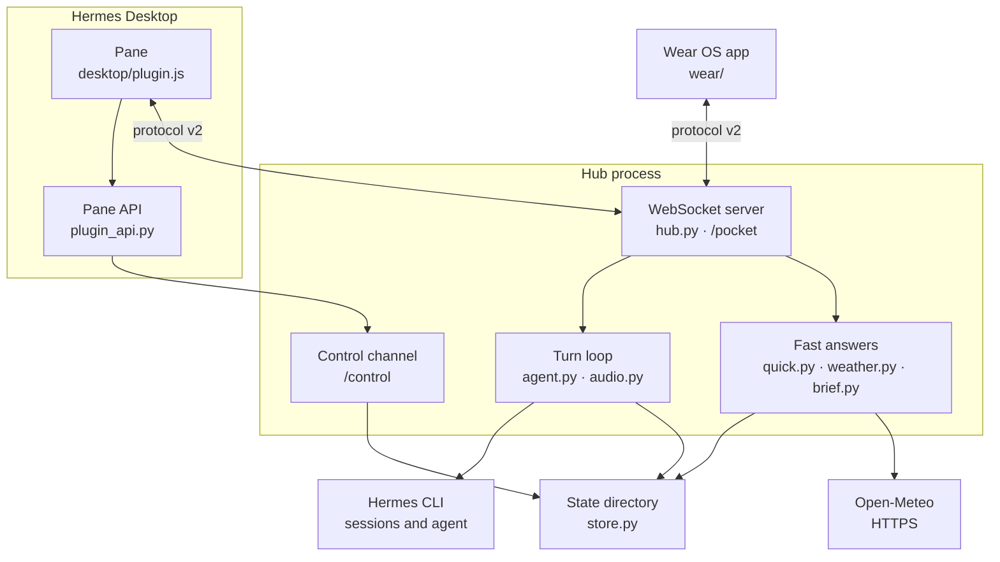

# Architecture

_How the hub, the pane, the watch client and the fast-answer modules fit together._

Applies to Hail Hermes 1.0.0 · revised 2026-11-11

## Components

| Path | What it does |
|---|---|
| `plugin/hail_hermes/hub.py` | `PocketHub`: WebSocket server, pairing, device sessions, turns, LAN discovery. |
| `plugin/hail_hermes/protocol.py` | Message constructors, limits and close codes; implements `protocol/PROTOCOL.md`. |
| `plugin/hail_hermes/store.py` | State directory: token hashes, control token, hub id, live snapshot. |
| `plugin/hail_hermes/agent.py` | Runs a turn through the `hermes` CLI and lists Hermes sessions. |
| `plugin/hail_hermes/audio.py` | STT and TTS backends (Hermes, Parakeet, Kokoro, Piper, edge-tts, espeak, stubs). |
| `plugin/hail_hermes/hermes_voice.py` | Guarded bridge to Hermes' internal speech modules. |
| `plugin/hail_hermes/quick.py` | Keyless OpenAI-compatible streaming answers, hand-off marker, memory. |
| `plugin/hail_hermes/weather.py` | Recognises weather questions and answers from Open-Meteo. |
| `plugin/hail_hermes/brief.py` | Instant schedule/email/work/trip answers from a local `brief.json`. |
| `plugin/hail_hermes/recap.py` | Reads a session's folder and last activity from Hermes' `state.db`. |
| `plugin/hail_hermes/models.py` | Lists visible models without reading a credential store. |
| `plugin/hail_hermes/settings.py` | Persistent settings, validation and character/voice resolution. |
| `plugin/hail_hermes/autostart.py` | Starts and restarts one hub per state directory. |
| `plugin/hail_hermes/control.py` | Synchronous loopback client for the `/control` channel. |
| `plugin/hail_hermes/tools.py` | The four agent tools and their capability checks. |
| `plugin/hail_hermes/cli.py` | `hermes hail` / `hermes pocket` commands. |
| `plugin/hail_hermes/dashboard/plugin_api.py` | FastAPI router mounted by Hermes as `/api/plugins/hail-hermes/`. |
| `plugin/hail_hermes/desktop/plugin.js` | The pane's source; `desktop/plugin.js` is the byte-identical copy the host loads. |
| `wear/` | Wear OS client: push-to-talk, playback, mascot, tile, discovery. |
| `android/` | Phone client, still protocol v1; not part of the 1.0.0 watch path. |
| `simulator/` | Device and hub simulator with its own pytest suite. |
| `tools/facesmith/` | Generates the 1-bit mascot frames. |

## Data flow

The pane and the watch speak the same WebSocket protocol; the pane adds REST routes for settings,
sessions, the soul editor and the bundled sample audio. Those routes reach the hub only through the
loopback `/control` channel, authenticated with a token file in the state directory.

## A turn

1. A client sends `text`, or `audio_start` + PCM frames + `audio_end`.
2. `hub.py` bounds the utterance (`min_utterance_bytes`, `max_audio_seconds`), then runs STT when the
   input was audio.
3. Fast paths run first: weather (`weather.py`), the day brief (`brief.py`), and quick-chat
   (`quick.py`). If none applies, `agent.py` runs the request through Hermes.
4. Text deltas are streamed back as `transcript` frames; speech is synthesised sentence by sentence
   and sent as `audio_start` / binary PCM / `audio_end`.
5. State changes (`idle`, `listening`, `thinking`, `speaking`) are pushed as `state` frames, with a
   `busy:true` repeat every three seconds while a turn runs.

## Data on disk

The state directory is chosen by `HAIL_HERMES_STATE`, then `HERMES_POCKET_STATE`, then
`<profile>/pocket` if it exists, otherwise `<profile>/hail-hermes`.

| File | Contents |
|---|---|
| `settings.json` | Validated settings (see [CONFIGURATION.md](CONFIGURATION.md)). |
| `devices.json` | Paired device metadata and SHA-256 token hashes. |
| `control.token` | Bearer token for the loopback control channel. |
| `hub.id` | Persistent random hub id; its SHA-256 prefix is the discovery fingerprint. |
| `live.json` | Running pid, port, control URL, devices and the latest mirror. |
| `turns.jsonl` | One JSON line per question and answer. |
| `hub.log` | Hub log, including turn failures. |
| `brief.json` | Editable local day brief; seeded with a labelled demo. |
| `soul.md` | The agent's personality text for voice turns. |
| `face.png` / `face.jpg` | An uploaded character face, if any. |
| `settings.lock`, `devices.lock`, `autostart.lock` | Interprocess locks. |

## Where the protocol lives

`protocol/PROTOCOL.md` is the single contract. Every message has `"v": 2`; audio is raw s16le,
16 kHz, mono, in nominal 640-byte frames. The shared examples in `protocol/fixtures/*.json` are
loaded by the Kotlin and Python codec tests, so a protocol change that breaks a client fails a suite.

## The duplicate desktop bundle

The desktop runtime evaluates a plugin as source and allows imports only from `@hermes/plugin-sdk`
and `react`. There is no shared module to import, so `desktop/plugin.js` and
`plugin/hail_hermes/desktop/plugin.js` must stay byte-identical. `plugin/tests/test_desktop_bundle.py`
enforces this; a re-export shim is a hard load failure.

---

Back to [docs/README.md](README.md).
