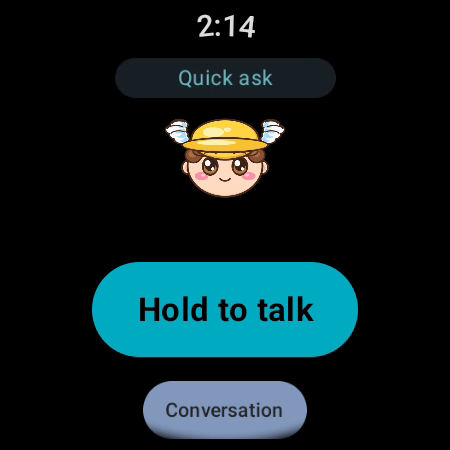

# Using Hail Hermes

_Every user-facing feature, in the order a new person meets it._

Applies to Hail Hermes 1.0.0 · revised 2026-11-11

## Open the panel

After installing the plugin and turning on its **Desktop part**, click **Hail Hermes** in the left
rail. The status-bar ⌚ and `Alt+Shift+H` are the quick paths to the same page. The header pill says
what the panel is doing: `Ready · Quick ask`, `Connecting…`, or `Hub not running`. Click it to open
Settings.

The pane needs no watch and no extra hardware. Everything below works in the panel unless a step
says "on the watch".

## Talk

The **Talk** tab is the home screen. It shows the live watch mirror, a text box, a hold-to-talk
button, and **Run the 60-second demo**.

- **Type** a message and press **Send**.
- **Hold to talk** while you speak; release to send the utterance. The first time, the browser asks
  for microphone permission.
- **Send sample question** sends the bundled `sample-question.wav` through the real hub, which is
  useful when you want to test speech without a microphone.
- **Run the 60-second demo** asks three real questions through the hub: the weather, what you were
  working on, and what the agent can do. The answers are spoken.

While a turn runs, the state badge goes `Thinking`, then `Speaking`. **Stop** interrupts the turn.
The next turn is told that the previous answer was interrupted, so the agent can offer to resume
instead of pretending nothing happened.

## The weather fast path

Ask a weather question — "Will it rain?", "What's the weather in Denver?", "Do I need an
umbrella?" — and the hub answers from Open-Meteo without waking the agent. The reply is one plain
sentence, usually in about three seconds. Set a home town in Settings; without one, the hub asks
where you are or falls back to the agent. A named place in the question wins over the saved home
town.

Weather questions are matched deliberately narrowly: "set the model temperature", "training run"
and "tell me about weather balloons" are not weather questions.

## The day brief

Questions about your schedule, inbox, current project or trip are answered from
`brief.json` in the state directory, without a model call. The file is seeded with a labelled demo
brief and is meant to be edited. That keeps common watch questions instant and offline.

## Sessions

The **Sessions** tab lists your past conversations and offers **Open in Hermes**, which opens the
real session in the host app. Three session slots are reserved for the watch: pin a session, and the
wrist can switch to it. "Continue the project I started on Tuesday" resolves to a real folder on
disk, not a new chat.

On the watch, the mode pill switches between **Quick ask** and **Session**:

- **Quick ask** keeps one running voice conversation and hands tool work to Hermes in the
  background.
- **Session** runs every turn in full Hermes and resumes the selected session.

## Character

The **Character** tab has personality templates, a voice picker with ▶ preview, and a face you can
upload (PNG or JPEG under 2 MB). Eight looks are shipped: `hermes`, `nous`, `nous-dark`,
`nous-light`, `nous-white`, `nous-soft`, `nous-teal`, `nous-warm`. The seven Nous looks share the
same idle/blink/talk artwork set; `listening` and `thinking` fall back to idle.

Personality templates write `soul.md`; **Use this personality** saves it. The agent reads that file
for voice turns.

## Settings

The **Settings** tab holds the setup check, the brain and voice choices, and everything else.

- **Check my setup** reports, in plain words, what is still missing. The usual answer is ffmpeg for
  speech; `hermes pm install --tools-only` installs it.
- **Brain** lists the models Hermes can see. The list is a union of local endpoints the panel can
  probe and the model names Hermes has cached; a listed name is visible, not proof that your account
  may use it.
- **Voice** picks the backend and the voice. The pane's ▶ button plays a short sample.
- **Watch** settings live behind **More** on Talk: let the watch connect, approve a code, and see
  paired devices.

## Pairing a watch

The watch app is a separate Android app; the plugin contains the computer half. Install the APK
from the latest release, then:

1. In the pane, press **Let my watch connect**.
2. Open Hermes Wear on the watch; it finds this computer on the same Wi-Fi.
3. The watch shows a four-digit code. Match it in the pane and press **Approve**.
4. Keep the watch screen awake while you approve. Codes expire after five minutes.

Approval happens on the computer over the loopback control channel. There is no automatic approval
path, even on loopback. Pairing once is permanent for that watch. To move to another computer, open
the ⚙ on the watch and choose **Pair a new computer**.

## On the watch

- **Hold to talk** for one question, or **Conversation** for hands-free back and forth.
- The mascot's mouth moves only while audio is actually playing.
- Settings on the wrist can change **Character**, **Voice**, **Model**, **Session** and **Speak
  replies** — but only what the pane's `watch_can_change` map allows.
- Model changes on the watch are limited to the five presets the pane saved, and only to models
  Hermes has already authorised.
- A **Wear tile** shows connection status, the mascot state and the latest transcript line.

<p align="center"></p>

## Phone client

`android/` is a phone client, but it still speaks protocol v1 and is closed by the hub with code
4000. It is not part of the 1.0.0 watch path; use the panel or the Wear OS app.

## Command line

```bash
hermes hail serve          # run the hub in the foreground
hermes hail restart        # stop the running hub and start a fresh one
hermes hail devices        # paired and connected devices
hermes hail pair list      # pending pairing requests
hermes hail settings       # print every setting
hermes hail models         # Quick ask models the saved endpoints expose
hermes hail slots          # session slots
```

`hermes pocket` is a compatibility alias. See [REFERENCE.md](REFERENCE.md) for every subcommand and
flag.

## Remove it

```bash
hermes plugins remove hail-hermes
```

Then delete `<profile>/hail-hermes` if you also want the settings, pairings and logs gone. Revoking
one watch is `hermes hail revoke <device-id>`.

---

Back to [docs/README.md](README.md).
